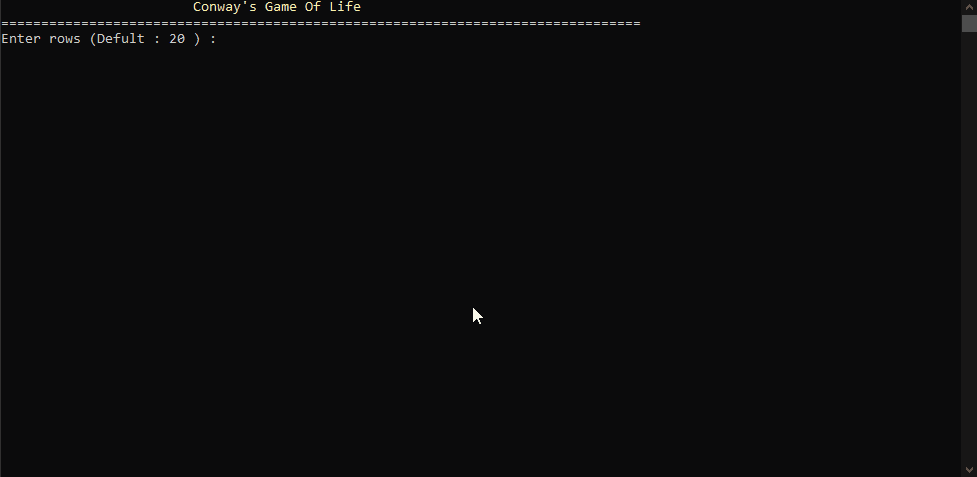

# Conway's Game of Life

**A terminal-based implementation of Conway's Game of Life, built from scratch in C++17.**

A cellular automaton in which simple rules governing individual cells produce surprisingly complex patterns and behavior. This project brings the simulation to life in the terminal, with random initialization, predefined patterns, configurable grid dimensions, and optional wraparound boundaries.

<!-- Replace this placeholder with your actual demo after recording it. -->



## Table of Contents

- [Overview](#overview)
- [Features](#features)
- [How It Works](#how-it-works)
- [Architecture](#architecture)
- [Project Structure](#project-structure)
- [What I Learned](#what-i-learned)
- [Build and Run](#build-and-run)
- [Technologies](#technologies)

## Overview

Conway's Game of Life is a zero-player cellular automaton developed by mathematician John Conway. It consists of a grid of cells, each of which can be alive or dead. The state of every cell evolves over discrete generations according to a small set of rules.

Despite its simplicity, the simulation can produce stable structures, oscillators, and patterns that travel across the grid.

The goal of this project was to implement the simulation in C++ while practicing modular design, separating responsibilities across classes, and rendering an evolving grid directly in the terminal.

## Features

- **Conway's Game of Life:** Implements the classic birth, survival, and death rules.
- **Configurable grid:** Choose the number of rows and columns.
- **Random initialization:** Populate the initial grid with randomly distributed living cells.
- **Predefined patterns:** Includes the Block, Blinker, Glider, Toad, Beacon, and Lightweight Spaceship.
- **Wraparound boundaries:** Optionally connect opposite edges of the grid so cells can interact across its boundaries.
- **Terminal animation:** Render successive generations using ANSI escape sequences.
- **Modular architecture:** Separate components for grid management, simulation, rules, rendering, terminal operations, and pattern generation.
- **Generation tracking:** Keep track of the simulation's progress as it evolves.

## How It Works

### The Rules

Each generation is calculated using four rules:

1. **Underpopulation:** A living cell with fewer than two living neighbours dies.
2. **Survival:** A living cell with two or three living neighbours survives.
3. **Overpopulation:** A living cell with more than three living neighbours dies.
4. **Reproduction:** A dead cell with exactly three living neighbours becomes alive.

All cells evolve simultaneously based on the state of the previous generation.

### Synchronous Updates

The simulation maintains separate current and next grids. Each generation is calculated from the current grid and written to the next grid before the new state replaces the old one.

This prevents updates to individual cells from influencing other cells prematurely within the same generation.

### Patterns

The project includes several classic Game of Life patterns:

- **Block:** A stable configuration that does not change.
- **Blinker:** A simple oscillator with a period of two generations.
- **Glider:** A pattern that travels diagonally across the grid.
- **Toad:** An oscillator that alternates between two states.
- **Beacon:** An oscillator formed from two interacting blocks.
- **Lightweight Spaceship:** A moving pattern that travels horizontally.

## Architecture

The project is organized into components with distinct responsibilities.

| Component    | Responsibility                                                                                 |
| ------------ | ---------------------------------------------------------------------------------------------- |
| `Grid`       | Stores cell states, manages grid dimensions, handles boundaries, and counts living neighbours. |
| `Simulation` | Manages generations and coordinates state transitions between the current and next grids.      |
| `Rules`      | Determines the next state of a cell according to Conway's rules.                               |
| `Renderer`   | Converts the grid into a terminal-friendly visual representation.                              |
| `Terminal`   | Handles terminal operations such as ANSI control sequences and animation timing.               |
| `Patterns`   | Defines and places predefined configurations on the grid.                                      |
| `Random`     | Handles random generation for the initial grid.                                                |
| `run.cpp`    | Coordinates the simulation setup and execution.                                                |

This separation keeps the simulation logic independent from the way the grid is displayed, making the code easier to understand, maintain, and extend.

## Project Structure

```text
GameOfLife/
├── include/          # Header files and declarations
├── src/              # C++ source files and implementations
├── assets/           # Demo GIF and other project visuals
└── README.md
```

## What I Learned

Building this project gave me practical experience with several C++ concepts:

- **Object-oriented programming:** Organizing functionality into classes with clear responsibilities.
- **Multi-file C++ projects:** Separating declarations into header files and implementations into source files.
- **Encapsulation and interfaces:** Keeping data and operations organized behind class interfaces.
- **STL containers:** Using `std::vector` to represent and manage a two-dimensional grid.
- **Simulation state management:** Updating a system across discrete generations without mixing old and new states.
- **Algorithms and problem-solving:** Implementing neighbour counting, boundary handling, and state-transition rules.
- **Random number generation:** Using the C++ standard library to produce randomized initial configurations.
- **Terminal rendering:** Using ANSI escape sequences to display and animate the simulation.
- **Modular design:** Dividing a larger problem into smaller components that can be developed and understood independently.
- **Build and debugging workflow:** Compiling a multi-file project with GCC and organizing it for use outside the original IDE.

## Build and Run

### Requirements

- A C++ compiler with C++17 support, such as GCC.
- A terminal that supports the ANSI escape sequences used by the renderer.

### Windows — PowerShell with MinGW-w64

Run these commands from the project root:

```powershell
g++ (Get-ChildItem src/*.cpp).FullName -Iinclude -o game_of_life.exe -std=c++17
.\game_of_life.exe
```

### Linux / macOS

Run these commands from the project root:

```bash
g++ src/*.cpp -Iinclude -o game_of_life -std=c++17
./game_of_life
```

## Technologies

- **Language:** C++17
- **Standard Library:** STL containers and random number generation
- **Rendering:** ANSI terminal escape sequences
- **Compiler:** GCC / MinGW-w64

---

_A hands-on C++ project exploring cellular automata, simulation logic, and modular software design._
